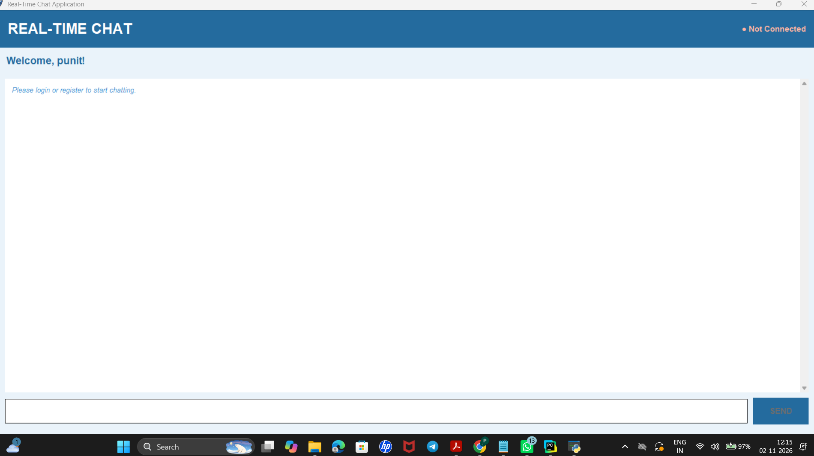

# Real-Time Chat Application

## Project Overview

A Python-based Real-Time Chat Application that allows multiple users to communicate instantly over a network using client-server architecture.

## Features

- User Registration and Login
- Secure Password Hashing
- Real-Time Messaging
- Multiple User Support
- Chat History
- SQLite Database Integration
- Tkinter Graphical User Interface
- Client-Server Communication using Python Sockets
- Multi-threading Support

## Technologies Used

- Python
- Tkinter
- Socket Programming
- SQLite3
- JSON
- Threading
- Hashlib

## Project Structure

```text
Real-Time-Chat-Application/
├── server.py
├── client.py
├── main.py
├── database.py
├── security.py
├── test_gui.py
├── chat.png.png
├── login.py.png
├── README.md
└── .gitignore
```

## Installation

### 1. Clone the Repository

```bash
git clone https://github.com/PunitPatil1029/Real-Time-Chat-Application.git
```

### 2. Open Project Folder

```bash
cd Real-Time-Chat-Application
```

### 3. Install Required Dependencies

```bash
pip install -r requirements.txt
```

Note: Make sure the required Python libraries are installed. Tkinter and SQLite3 are included with most standard Python installations.

## How to Run

### 1. Start the Server

Open the first terminal and run:

```bash
python server.py
```

### 2. Start the Client

Open another terminal and run:

```bash
python client.py
```

### 3. Register or Login

Create a new account or log in using an existing account.

## Database

The application uses SQLite to store user information and chat messages.

## Security

Passwords are protected using PBKDF2-HMAC-SHA256 hashing to improve password security.

## Screenshots

### Login Screen


### Chat Window



## Project Purpose

This project demonstrates Python GUI development, socket programming, database management, secure authentication, and real-time client-server communication.

## Future Improvements

- Online User Status
- Group Chat Functionality
- File Sharing
- Improved User Interface

## Author

**Punit Patil**

GitHub: [PunitPatil1029](https://github.com/PunitPatil1029)
